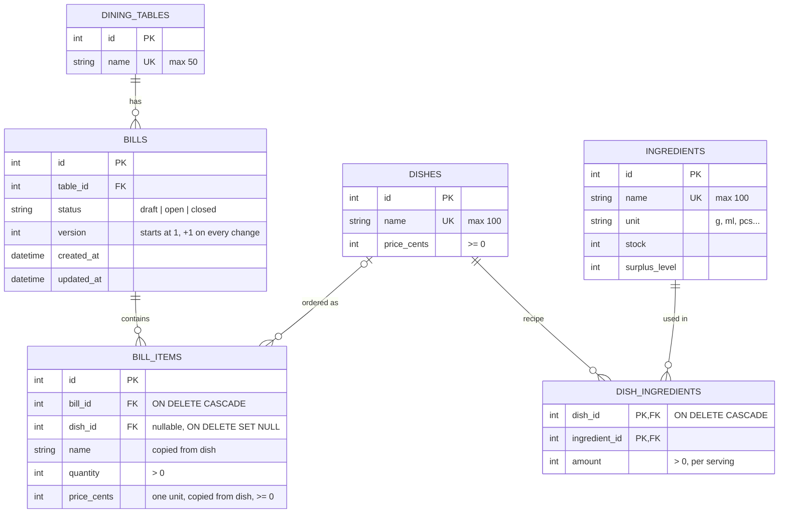

# Data model

Each service owns its own database. The two databases are never joined; the Split Service
refers to bills and bill items only by their IDs and reads them from the Bill Service over HTTP.

## Bill Service (`billdb`)

Defined in `services/bill_service/app/models.py`, created by migration
`services/bill_service/migrations/versions/85e7db8acbe9_create_bill_tables.py`.

| Table | Purpose | Notes |
|---|---|---|
| `dining_tables` | Restaurant tables (QR code target) | Called `dining_tables` because `Table` is reserved in SQLAlchemy; the API still uses `/tables`. A table with bills cannot be deleted. |
| `bills` | One check per table visit | `status` is enforced by a database check constraint. Only one bill per table can be `open`. `version` lets the Split Service detect edits. |
| `bill_items` | Lines on a bill | `name` and `price_cents` are copied when the item is added, so later menu changes do not alter existing bills. `total_cents` (= `price_cents × quantity`) is calculated, not stored. |
| `dishes` | Menu | Deleting a dish keeps old bill items (their `dish_id` becomes empty). |
| `ingredients` | Stock | Cannot be deleted while a recipe uses it. |
| `dish_ingredients` | Recipes | Composite primary key, so an ingredient appears at most once per recipe. |

All money is stored as **integer cents** to avoid floating-point rounding errors.

## Split Service

_To be added by the Split Service owner._
